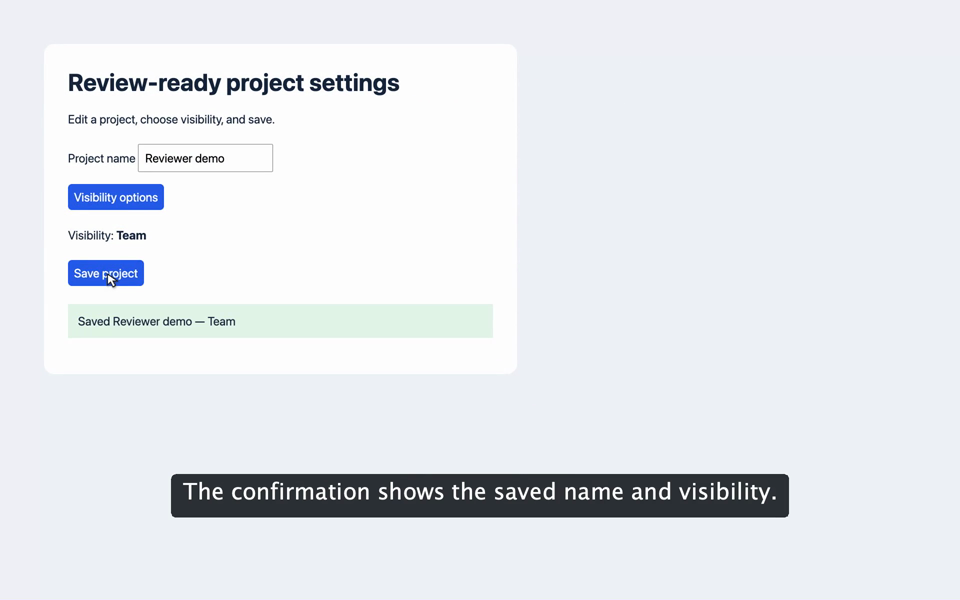

# If you’re allergic to vibe-coded apps, turn away immediately.

**Agent Demo lets coding agents turn finished browser features into narrated demo videos that help reviewers understand what changed.**

[](https://github.com/juniusfree/agent-demo/releases/download/demo-v1/agent-demo.mp4)

[▶ Watch or download the demo (17 seconds, MP4)](https://github.com/juniusfree/agent-demo/releases/download/demo-v1/agent-demo.mp4)

## agent-demo

A local, agent-operated browser demo tool written in Clojure.

An agent writes **data describing the demonstration**, not another recorder:
the supplied adapter executes browser actions, captures footage and events,
and renders narration, captions, cursor effects, and eased zooms to MP4.
Reviewers see the finished behavior, not the agent's development session.

**Status:** working first slice, verified against the bundled fixture. Not a
Screen Studio feature-complete replacement or a correctness/audit tool.

## Requirements

- Clojure CLI and JDK 17+.
- Installed Google Chrome, or an explicit Chromium executable.
- FFmpeg with H.264/AAC encoding and FFprobe on PATH.
- Playwright's recording helper (one explicit download):
  `clojure -M -m com.microsoft.playwright.CLI install ffmpeg`
- A **preinstalled**, OpenAI-compatible Kokoro service exposing
  `GET /health` (`{"status":"ok"}`) and `POST /v1/audio/speech`.

Clojure resolves pinned Maven dependencies on first use. Capture disables
Playwright's automatic browser downloads and defaults to installed Chrome.
Nothing installs or downloads Kokoro. No cloud speech fallback exists.

## Run the fixture

From this directory, start the fixture in one terminal:

```sh
clojure -M:run fixture
```

In another:

```sh
clojure -M:run validate examples/fixture.edn
clojure -M:run capture examples/fixture.edn work/capture-v1
clojure -M:run render examples/fixture.edn work/capture-v1/capture.edn work/render-v1
open work/render-v1/demo.mp4
```

Every capture/render requires a **new output directory**. Failed runs retain
their partial artifacts for diagnosis; use a new directory when retrying.

## Agent contract

1. Use an authorized, disposable application fixture.
2. Write an EDN project with a narration and action sequence per scene.
3. Start with a `:goto` action. Initial navigation is excluded from exported
   content, so the first scene opens on the app rather than browser setup.
4. Use explicit waits for visible completion, not guessed save delays.
5. End a scene with `:checkpoint` only when its final frame is safe to hold.
6. Capture once. Review the real results before narrating success.
7. Edit narration and focus, then render again from the same capture.
8. Inspect final frames and listen before sharing. The tool does not judge
   whether narration is true.

This version runs a **batch of agent-authored actions**. The agent chooses
everything; the adapter does not plan or explore. Interactive per-action CLI
sessions, MCP, popups, iframe targeting, and arbitrary JavaScript actions are
not implemented.

### Project data

```clojure
{:version 1
 :viewport {:width 1920 :height 1200}
 :browser {:executable "/absolute/path/to/chromium"
           ;; Optional private Playwright storage-state file; never commit it.
           :storage-state "/private/path/session.json"}
 :kokoro {:endpoint "http://127.0.0.1:8880"
          :voice "af_heart"
          :command ["/absolute/path/to/preinstalled-kokoro" "serve"]
          :startup-timeout-ms 60000}
 :scenes
 [{:id "rename"
   :narration "Give the project a recognizable name."
   :focus-selector "#name"
   :actions [{:op :goto :url "http://localhost:3000"}
             {:op :fill :selector "#name" :text "Reviewer demo"}
             {:op :checkpoint}]}]}
```

Omit `:browser` to use installed Chrome with a fresh isolated context.
The sample Kokoro command is illustrative: configure the actual foreground
launcher for your installation. Do not configure a daemonizing launcher.

Supported action maps:

| Operation | Fields | Behavior |
| --- | --- | --- |
| `:goto` | `:url` | Navigate to HTTP(S) URL |
| `:click` | `:selector` | Smooth cursor movement, click pulse, real click |
| `:fill` | `:selector :text` | Move cursor, then fill the real field |
| `:hover` | `:selector` | Move cursor, then hover |
| `:wait-visible` | `:selector` | Wait for visibility |
| `:wait-text` | `:selector :text` | Wait for a unique CSS match containing text |
| `:checkpoint` | none | Mark the stable end of a scene as holdable |

Use unique CSS selectors. Actions/waits time out after 15 seconds. A failure
aborts capture; it does not claim a successful demo. Browser operations can
change real application data: isolation is **not** authorization to mutate
production.

### Revising without recapture

Copy/edit the project, retaining scene IDs, order, and actions. Narration,
cuts, and the camera track are presentation data; none requires recapture.
A scene's `:focus-selector` records normalized geometry in `capture.edn`
for the agent to reference. It does not move the camera automatically.

### Persistent camera track

Omit `:camera` (or use `:camera []`) for a stationary full view. To direct
the camera, add this **top-level** project field:

```clojure
:camera
[{:at {:scene "name" :time 0.4}
  :zoom 1.35
  :focus {:x 0.20 :y 0.26}
  :transition 0.6}

 {:at {:scene "save" :time 0.5}
  :zoom 1.0
  :transition 0.6}]
```

The camera transitions in, **holds the exact framing across scenes**, then
returns to full view only when instructed. There is no automatic zoom-out,
scene reset, or repeated in/out curve.

- `:at :time` is seconds from the named scene's **original captured start**.
  It must be within that source scene, including its end checkpoint.
- `:zoom` is 1–2.5. A value of 1 returns to the full viewport.
- Zoomed instructions require `:focus {:x ... :y ...}`, normalized 0–1
  against the original viewport. Framing clamps at viewport edges.
- `:transition` is seconds of eased motion, default 0.5. Zero changes the
  framing immediately. Motion uses smoothstep interpolation.
- The target holds indefinitely after the transition. Transitions may cross
  scene boundaries or continue during a narration checkpoint hold.
- If an instruction interrupts a transition, it starts from the current
  interpolated framing, not the previous target.
- List instructions in strict scene/time order; duplicate anchors are errors.
- Cuts remap retained anchors to edited time. An anchor inside a removed
  interval is an error: the agent must reposition it explicitly.
- Narration holds in earlier scenes shift later camera anchors automatically.
  Camera instructions do not extend the video; unfinished transitions stop
  at the end of the export.
- Timing is evaluated at 30 fps. Source footage and captions remain separate:
  captions never zoom with the browser.

**Migration:** remove the old `:zoom?` field and scene-level `:focus` maps.
They now produce actionable validation errors rather than silently changing
behavior. Put zoom/focus choices in `:camera` instead. Existing source
recordings remain reusable; captured legacy focus metadata is only a hint.

```sh
clojure -M:run render revised.edn work/capture-v1/capture.edn work/render-v2
```

Changing actions, adding/removing scenes, or reordering scenes requires a new
capture. The renderer rejects mismatched actions rather than suggesting they
ran. Capture manifests are trusted local data, not tamper-proof evidence.

## Agent-directed cuts

Add `:cuts` to an existing scene, then render again from the original capture:

```clojure
{:id "save"
 :narration "Save the project. The updated result appears."
 :cuts [{:start 1.2 :end 4.8}]
 ;; Keep the originally captured :actions unchanged.
 :actions [...]}
```

This removes footage from 1.2 seconds (inclusive) to 4.8 seconds (exclusive),
**relative to that scene's captured start**, not the complete recording or
edited output. The tool never chooses cuts automatically.

- Inspect source footage to choose boundaries. Absolute recording timestamps
  equal scene `:start` in `capture.edn` plus the cut's scene-relative time.
  Diagnostic action-event clocks are not exact encoded-frame timestamps.
- List cuts in ascending order without overlap. Boundaries snap forward to
  the 30 fps frame grid; each cut must remove at least one frame.
- Preserve the final scene frame: cuts ending at/beyond the scene end are
  rejected. This keeps the original checkpoint available for narration holds.
- Retained footage plays at normal speed, joined by hard cuts.
- Narration remains continuous; cuts affect browser footage, not speech.
  The planner recalculates scene lengths, subsequent scene starts, and
  sentence-caption timing from measured audio. It does not align spoken
  claims to particular browser actions; the agent must review that alignment.
- If narration outlasts shortened footage, the final checkpoint holds longer.
  **A cut may therefore not shorten the final video.** Shorten narration too
  when necessary. Without a checkpoint, excess narration still fails.
- Raw footage stays intact. Remove or revise cuts freely without recapture.

## Timing and presentation

- Default 1920×1200, 30 fps H.264/AAC capture and export; at most 62 scenes.
  Set `:viewport {:width 1920 :height 1080}` for 16:9, for example.
  Dimensions must be even integers: width 640–2560, height 400–1600.
  Changing an explicit viewport requires recapture, not upscaling old footage.
  Older projects without `:viewport` still render at their recorded dimensions.
- The browser viewport includes an extra 16px synchronization strip. Encoded
  color markers establish scene boundaries; the renderer crops the strip out.
  This avoids freezing stale frames because browser commands and encoded
  frames arrive at different times.
- Cursor movement and click pulses are temporary pointer-transparent overlays
  captured in footage. They do not alter business values. **Cursor styling is
  baked in**, unlike editable zooms, captions, and narration.
- Camera movement is off by default. The explicit `:camera` track controls
  transitions and persistent framing. Enabled camera transforms
  use a 4× full-chroma working image to reduce pixel-rounding jitter; output
  stays at the capture dimensions. This uses more rendering time and memory.
- Spoken text splits only at sentence boundaries, never at caption word counts.
  Each complete sentence has a measured Kokoro WAV, preserving within-sentence
  prosody. Its verbatim caption wraps visually into at most two lines. Shorten
  an oversized sentence rather than splitting its audio arbitrarily. This is
  sentence-level synchronization, not word-level forced alignment.
- Voice defaults: `af_heart`, generation speed 0.95, then pitch-preserving
  `atempo=1.25`.
- Longer narration holds the scene's final frame only if capture recorded a
  final checkpoint. Holds carry a small “Paused” label. Actions retain their
  original speed. Without a checkpoint, shorten narration or recapture.
- Captions render after zoom, scale proportionally with the viewport, and
  stay above player controls.
  There is no automatic UI collision avoidance; review framing and caption
  clearance. There is no automatic wait trimming or sensitive-data masking.

## Kokoro lifecycle

The tool checks the configured loopback origin before generating speech:

1. Reuse a healthy existing service without taking ownership.
2. Otherwise execute the configured command directly (no shell interpolation).
3. Wait for health, bounded by the startup timeout.
4. Generate speech; on success or failure, terminate only the owned process
   and its descendants.

Startup logs live in the render directory's `kokoro.log`. Missing
configuration, timeout, an exited process, or a failed speech request produces
an error. Source capture remains available. Concurrent renders should share an
externally managed Kokoro service; owned service startup is not coordinated
across CLI processes.

## Files and privacy

Capture directory:
- `project.edn`: original project configuration.
- `capture.edn`: absolute source path, encoded scene bounds, actions and events.
- `raw/*.webm`: original private recording, including synchronization/setup.

Render directory:
- `demo.mp4`: shareable only after review.
- `project.edn`, `timeline.edn`: reproducible presentation decisions and timings.
- Per-cue WAVs, caption PNGs, intermediate scene videos.
- `verification.edn`: render metadata and outstanding review checks.

Events use a monotonic action clock for diagnostics; only encoded marker
bounds drive video cuts. Capture manifests use absolute paths: update
`:source` if deliberately relocating footage.

Keep raw footage, authentication state, logs, and configuration private.
The tool does not upload anything, redact recordings, or package artifacts
for sharing. EDN cannot execute code through the reader, but a configured
Kokoro command **is executable configuration**: use trusted project files.

## Functional architecture

| Namespace | Responsibility |
| --- | --- |
| `core` | Pure validation, cue segmentation, cut and narration timeline planning |
| `camera` | Pure camera validation, anchor remapping, persistent state, FFmpeg expressions |
| `capture` | Playwright browser adapter and encoded boundary extraction |
| `speech` | Local HTTP and owned-process lifecycle |
| `render` | Caption rasterization and FFmpeg composition |
| `io` | EDN files and external process boundary |
| `main` | CLI and local fixture server |

The rendering plan is ordinary immutable EDN. No browser handles, subprocesses,
or mutable agent session state enter the planner. Java AWT rasterizes caption
images so the renderer does not depend on FFmpeg's optional libass/drawtext
filters. Java Playwright is the browser bridge; the only JavaScript is the
small UI overlay and browser evaluation needed by the adapter.

## Tests

```sh
clojure -M:test
clojure -M:test-zoom
clojure -M:test-cuts work/cut-check-v1
clojure -M:smoke work/acceptance-v1
```

The cut regression renders a synthetic action/wait/result recording and
verifies that the action and result survive while the wait and its duration
are removed. It needs FFmpeg but no browser or speech service.

Unit tests cover invalid projects/captures, agent-directed cuts, pure timing, explicit checkpoints,
revisions, marker decoding, loopback-only speech, and service ownership/failure
cleanup. No browser or speech service is needed for unit tests.

The smoke test needs the requirements above. It starts an ephemeral local
fixture, tests a synthetic stale-frame regression, captures real interactions,
renders twice with different narration/zoom, decodes both outputs, checks
audio/video streams and durations, verifies the source hash stays unchanged,
and extracts final frames for review. It never restarts an existing service.

See [verification.md](verification.md) for the implementation run's evidence
and remaining limitations.
